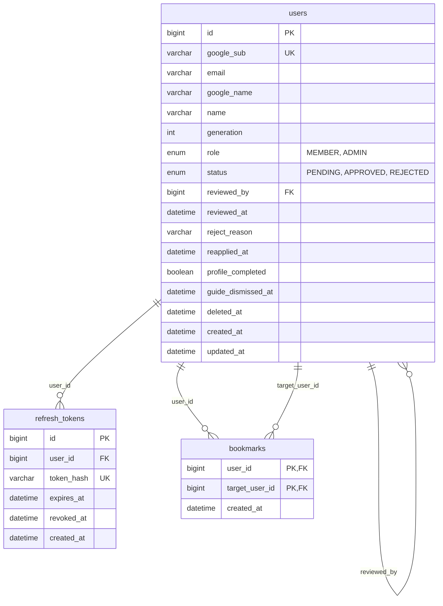
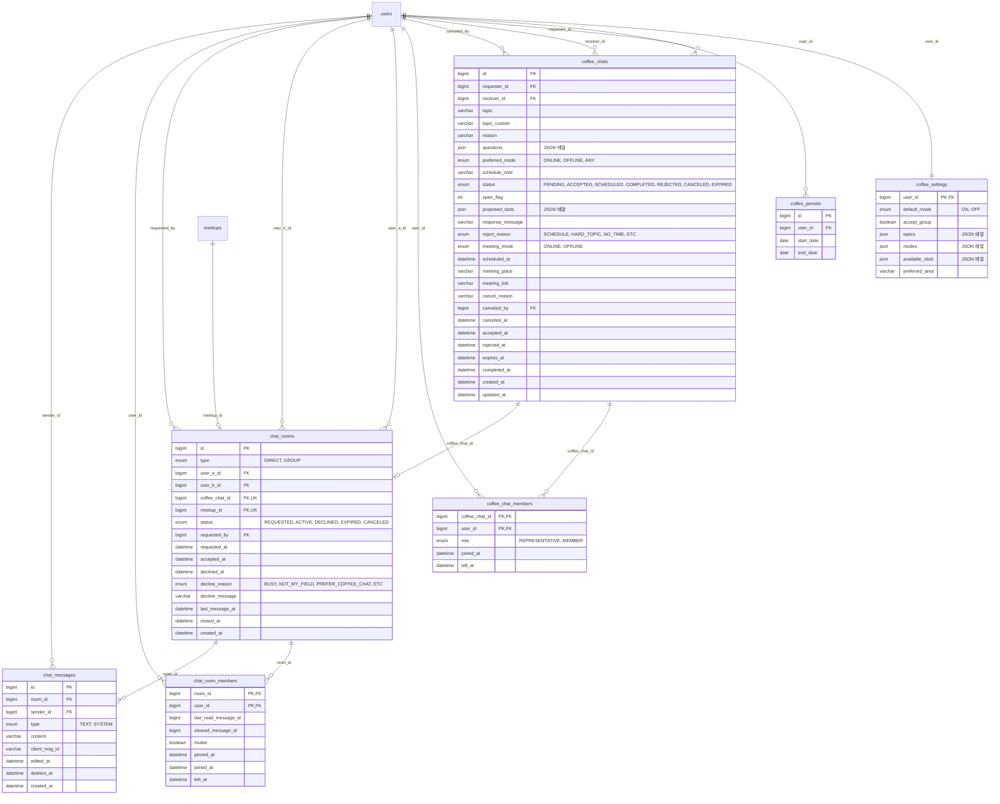
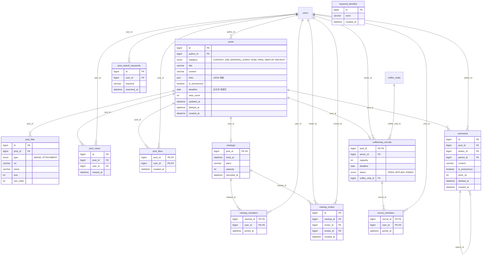
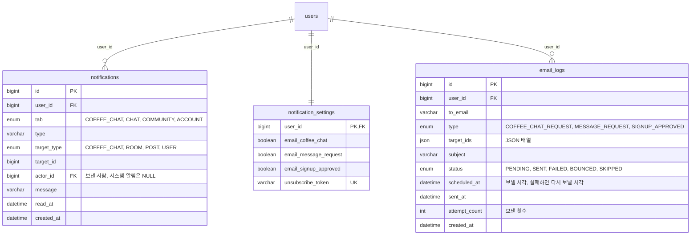

# LION LINK ERD

> 기준: `develop` 브랜치 엔티티 코드 (2026-11-12, 테이블 34개). 엔티티 코드를 읽어 생성했다.
> 엔티티를 바꾸면 이 문서도 다시 생성한다.

## 읽는 법

- **PK** 기본키, **FK** 다른 테이블의 ID를 담는 컬럼, **UK** 단일 컬럼 UNIQUE. 여러 컬럼 UNIQUE는 아래 표에 적었다
- 대부분 엔티티는 연관관계 대신 `Long userId` 같은 ID 필드를 쓴다. 그래서 DB 외래키 제약은 `@ManyToOne`/`@OneToOne`으로 매핑한 곳(채팅방·커피챗 멤버, 댓글, 게시글 하위 테이블 등)에만 생기고, 나머지는 논리적인 FK다
- `users`와 연결된 FK가 많아서 도메인별로 그림을 나눴다. 각 그림의 빈 `users` 상자는 회원 테이블을 가리킨다
- enum 컬럼은 따옴표 안에 값 목록, JSON 컬럼은 `JSON 배열`, 년월은 `YYYY-MM` 문자열
- 공통: 시간은 KST, 삭제는 소프트 삭제(`deleted_at`). `created_at`·`updated_at`은 JPA Auditing이 채운다
- enum 컬럼에는 Hibernate가 테이블을 만들 때 허용값 CHECK 제약(`posts_chk_1` 등)을 같이 만든다. `ddl-auto: update`는 이 제약을 고치지 않으니, enum 값을 바꾸면 기존 DB에서 제약을 직접 지워야 한다. 지금까지 지운 것: `posts_chk_1`(게시글 카테고리), `coffee_chats_chk_2`(커피챗 희망 방식 `ANY` 추가), `chat_rooms_chk_1`(메시지 요청 거절 사유 `PREFER_COFFEE_CHAT` 추가), `notifications_chk_1`(알림 탭 `CHAT` 추가)

## 테이블 목록

| 영역 | 테이블 | 설명 |
| --- | --- | --- |
| 회원·인증 | `users` | 회원. 구글 계정(sub·이메일·이름), 가입 때 입력한 이름·기수, 역할(MEMBER/ADMIN), 승인 상태(PENDING/APPROVED/REJECTED). 탈퇴는 `deleted_at` 기록 + `google_sub` NULL |
| 회원·인증 | `refresh_tokens` | 리프레시 토큰. 원문이 아닌 SHA-256 해시만 저장. `revoked_at`으로 폐기 |
| 회원·인증 | `bookmarks` | 관심 동문. (회원, 대상 회원) 복합 PK |
| 프로필 | `profiles` | 회원과 1:1. 멋사 파트(최대 2개), 현재 상태, 관심 분야·대표 기술(JSON), 소개, 연락처, 항목별 공개 범위 |
| 프로필 | `careers` | 경력 |
| 프로필 | `educations` | 학력 |
| 프로필 | `lion_activities` | 멋사 활동 이력. 회원별 기수당 1개(UNIQUE). 가입 기수 항목은 `is_default` |
| 프로필 | `lion_projects` | 멋사 프로젝트·해커톤 |
| 프로필 | `projects` | 멋사 밖 프로젝트 |
| 프로필 | `certifications` | 자격증 |
| 프로필 | `awards` | 수상 |
| 프로필 | `activities` | 대외활동 |
| 프로필 | `languages` | 언어. 회원별 언어 UNIQUE |
| 커피챗·채팅 | `coffee_settings` | 커피챗 받기 설정. 회원과 1:1 |
| 커피챗·채팅 | `coffee_periods` | 커피챗 받는 기간·쉬는 기간 |
| 커피챗·채팅 | `coffee_chats` | 커피챗 신청. 같은 두 사람 사이 진행 중 1건만(UNIQUE requester_id, receiver_id, open_flag — 진행 중이면 open_flag=1, 끝나면 NULL) |
| 커피챗·채팅 | `coffee_chat_members` | 여러 명 커피챗의 신청자들 (대표/함께 신청자) |
| 커피챗·채팅 | `chat_rooms` | 채팅방. 1:1(DIRECT, UNIQUE user_a_id·user_b_id)과 커피챗 단체방(GROUP, 커피챗당 1개), 번개 단체방(GROUP, 번개당 1개, `meetup_id` UNIQUE). 취소된 번개 방은 `closed_at`이 채워지고 더 보낼 수 없음 |
| 커피챗·채팅 | `chat_room_members` | 채팅방 참여자. 읽음 위치·알림 끄기·상단 고정 |
| 커피챗·채팅 | `chat_messages` | 메시지. (sender_id, client_msg_id) UNIQUE로 중복 전송 방지 |
| 커뮤니티 | `posts` | 게시글. 카테고리별(공모전·채용·족보·세미나·지금 사자는·자유·번개·커피챗), 익명 가능 |
| 커뮤니티 | `post_files` | 게시글 이미지·첨부파일 |
| 커뮤니티 | `post_views` | 조회 기록 |
| 커뮤니티 | `post_likes` | 게시글 좋아요. (게시글, 회원) 복합 PK |
| 커뮤니티 | `comments` | 댓글. `parent_id`로 대댓글, 익명 번호 `anon_no` |
| 커뮤니티 | `meetups` | 번개 모임. 게시글과 1:1 (post_id가 PK) |
| 커뮤니티 | `meetup_members` | 번개 참여자 |
| 커뮤니티 | `meetup_invites` | 번개 초대 |
| 커뮤니티 | `coffeechat_recruits` | 커피챗 함께 신청 모집. 게시글과 1:1 |
| 커뮤니티 | `recruit_members` | 모집 참여자 |
| 커뮤니티 | `keyword_blocklist` | 금칙어 |
| 커뮤니티 | `post_search_keywords` | 커뮤니티 검색어 기록(인기 키워드). (user_id, keyword) UNIQUE라 회원별 키워드당 1줄, 7일 지나면 지움 |
| 알림 | `notifications` | 인앱 알림. 탭(커피챗, 채팅, 커뮤니티, 계정), 대상(target_type, target_id), 보낸 사람(actor_id) |
| 알림 | `notification_settings` | 이메일 알림 설정과 수신 거부 토큰. 회원과 1:1 |
| 알림 | `email_logs` | 메일 발송 기록 |

## 다이어그램

### 회원·인증

### 프로필

```mermaid
erDiagram
  users ||--|| profiles : "user_id"
  users ||--o{ careers : "user_id"
  users ||--o{ educations : "user_id"
  users ||--o{ lion_activities : "user_id"
  users ||--o{ lion_projects : "user_id"
  users ||--o{ projects : "user_id"
  users ||--o{ certifications : "user_id"
  users ||--o{ awards : "user_id"
  users ||--o{ activities : "user_id"
  users ||--o{ languages : "user_id"
  profiles {
    bigint user_id PK,FK
    enum lion_part_1 "PLANNING, DESIGN, FRONTEND, BACKEND"
    enum lion_part_2 "PLANNING, DESIGN, FRONTEND, BACKEND"
    enum status "STUDENT, LEAVE, GRADUATED, EMPLOYED, FOUNDER, GRAD_SCHOOL, ETC"
    json interests "JSON 배열"
    json skills "JSON 배열"
    varchar photo_url
    varchar headline
    varchar bio
    varchar major
    varchar minor
    varchar region
    json links "JSON 배열"
    varchar contact_email
    varchar phone
    enum email_visibility "PUBLIC, CONNECTED, PRIVATE"
    enum phone_visibility "PUBLIC, CONNECTED, PRIVATE"
    enum links_visibility "PUBLIC, CONNECTED, PRIVATE"
    enum company_visibility "PUBLIC, CONNECTED, PRIVATE"
    datetime created_at
    datetime updated_at
  }
  careers {
    bigint id PK
    bigint user_id FK
    varchar company
    varchar title
    enum employment_type "FULL_TIME, CONTRACT, INTERN, FREELANCE, FOUNDER, ETC"
    varchar start_ym "YYYY-MM"
    varchar end_ym "YYYY-MM"
    boolean is_current
    varchar description
  }
  educations {
    bigint id PK
    bigint user_id FK
    varchar school
    varchar major
    enum degree "BACHELOR, MASTER, DOCTOR, EXCHANGE_ETC"
    varchar start_ym "YYYY-MM"
    varchar end_ym "YYYY-MM"
    boolean is_current
    varchar description
  }
  lion_activities {
    bigint id PK
    bigint user_id FK
    int generation
    enum role "LION, STAFF, PRESIDENT, PART_LEAD, ETC"
    enum part_1 "PLANNING, DESIGN, FRONTEND, BACKEND"
    enum part_2 "PLANNING, DESIGN, FRONTEND, BACKEND"
    boolean is_default
  }
  lion_projects {
    bigint id PK
    bigint user_id FK
    varchar name
    enum event_type "REGULAR, JUNGKATHON, UNION_HACKATHON, ETC"
    int generation
    varchar my_role
    varchar description
    varchar link
  }
  projects {
    bigint id PK
    bigint user_id FK
    varchar name
    varchar start_ym "YYYY-MM"
    varchar end_ym "YYYY-MM"
    boolean is_current
    varchar role
    varchar description
    varchar link
    json tags "JSON 배열"
  }
  certifications {
    bigint id PK
    bigint user_id FK
    varchar name
    varchar organization
    varchar date "YYYY-MM"
  }
  awards {
    bigint id PK
    bigint user_id FK
    varchar name
    varchar organization
    varchar date "YYYY-MM"
    varchar description
  }
  activities {
    bigint id PK
    bigint user_id FK
    varchar name
    varchar organization
    varchar start_ym "YYYY-MM"
    varchar end_ym "YYYY-MM"
    varchar description
  }
  languages {
    bigint id PK
    bigint user_id FK
    varchar language
    enum level "BASIC, DAILY, BUSINESS, NATIVE"
  }
```

### 커피챗·채팅

### 커뮤니티

### 알림

## 팀 초안 SQL(`Lionlink.sql`)과 다른 점

- `invitations` 없음: 기능명세서 v1.17에서 초대 링크 가입이 빠지고, 누구나 구글로 가입 신청 → 운영진 승인으로 바뀜
- `users`: `approved_by`/`approved_at`/`rejection_reason` → `reviewed_by`/`reviewed_at`/`reject_reason`, 재신청 시각 `reapplied_at`, 가이드 닫은 시각 `guide_dismissed_at` 추가
- `refresh_tokens` 추가: 리프레시 토큰을 Redis 대신 DB에 해시로 저장
- `profile_visibility` 대신 `profiles`의 항목별 공개 범위 컬럼, 관심 분야·기술은 `profiles`의 JSON 컬럼
- 차단·커피챗 감사 인사 기능은 v1.17에서 빠져서 관련 테이블이 없다

## 확인 필요

- `coffee_chats`의 `topic_custom`, `meeting_link`, `updated_at`을 남길지 (명세상 꼭 필요한지 커피챗 담당과 확인)
