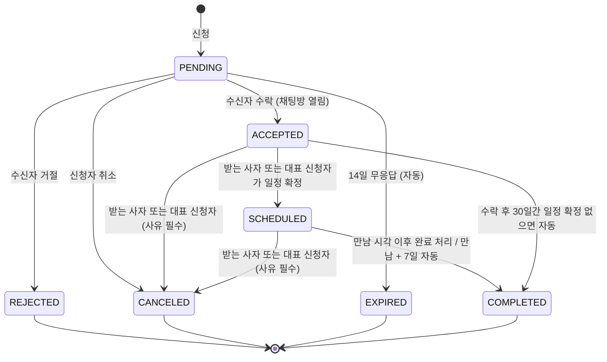

# LION LINK PRD

> 기능 요구사항 문서. 원본: 기능명세서 v1.17 (59행 — 동작·비즈니스 규칙·예외·문구는 원본을 따른다)
> 배경·타겟·MVP는 [planning.md](./planning.md), 데이터는 [erd.md](./erd.md), API는 [api.md](./api.md)
> 마지막 갱신: 2026-11-12

## 1. 사용자와 상태

| 대상 | 설명 | 쓸 수 있는 것 |
| --- | --- | --- |
| 비회원 | 로그인하지 않은 사람 | 로그인·회원가입·안내 페이지만 |
| 승인 대기 (`PENDING`) | 가입은 했지만 운영진 승인 전 | 프로필 설정만. 다른 동문에게 보이지 않는다 |
| 반려 (`REJECTED`) | 운영진이 반려한 회원 | 반려 사유 확인, 이름·기수 고쳐서 다시 신청 |
| 회원 (`APPROVED`) | 승인된 멋사 중앙대 동문(모든 기수) | 모든 기능 |
| 관리자 (`ADMIN`) | 운영진 계정. DB에서 역할을 직접 지정 | 회원 기능 + 가입 승인 등 관리자 기능 |

용어 (0.1)
- 화면에서는 회원을 모두 **'사자'**라고 부른다. 커피챗을 받는 회원은 '받는 사자', 보낸 회원은 '신청자'
- 커피챗: 상담 신청서 형식. 수락되면 요청 절차 없이 채팅방이 바로 열린다
- 채팅: 누구에게나 메시지 요청을 보낼 수 있고, 받는 사람이 수락해야 대화가 시작된다

## 2. 핵심 흐름

1. 구글로 계속하기 → (처음이면) 이름·기수 입력, 개인정보 동의 → 가입 신청(승인 대기)
2. 프로필 기본 정보 입력(온보딩) → 운영진 승인을 기다리며 프로필 채우기
3. 운영진 승인 → 승인 메일 → 동문 찾기·커피챗·채팅·커뮤니티 이용
4. 동문 찾기에서 선배 프로필 확인 → 커피챗 신청 → 수락되면 채팅방 → 일정 확정 → 만남 완료

## 3. 커피챗 상태 (0.2)

진행 중 = 대기 중·수락됨·일정 확정. 종료 = 거절됨·취소됨·만료됨·완료. 아래 경로 외의 변경은 모두 409.

## 4. 기능 요구사항

우선순위: **P0** = MVP 필수, **P1** = MVP에 넣으면 좋음, **P2** = 후순위.

### 0. 공통 정의

| ID | 기능 | 우선순위 | 화면 | 요약 |
| --- | --- | --- | --- | --- |
| 0.1 | 용어·역할 정의 | P0 | 전체 | 명세서 전체에서 쓰는 용어와 사용자 역할을 하나로 맞춘다. |
| 0.2 | 커피챗 상태 정의 | P0 | 내 커피챗, 채팅 | 커피챗 한 건이 가질 수 있는 상태와 상태가 바뀌는 조건을 정의한다. FE·BE 모두 이 표를 기준으로 분기한다. |
| 0.3 | 공통 에러·로딩 처리 | P0 | 전체 | 모든 화면에 똑같이 적용하는 에러·로딩·빈 화면 처리 규칙. |
| 0.4 | 지원 환경 (데스크톱 기준 · 휴대폰도 같은 화면으로 이용) | P0 | 전체, 휴대폰 안내 배너, 인앱 브라우저 안내 팝업 | PC(데스크톱) 화면을 기준으로 만든다. 휴대폰·태블릿 전용 화면은 따로 만들지 않지만, 들어와도 막지 않고 데스크톱 화면 그대로 쓸 수 있게 한다. |

### 1. 계정·인증

| ID | 기능 | 우선순위 | 화면 | 요약 |
| --- | --- | --- | --- | --- |
| 1.2.1 | 가입 승인 (관리자) | P0 | 관리자 > 가입 승인 | 구글 계정으로 가입 신청한 사람이 정말 멋사 중앙대 동문인지 운영진이 확인해 승인한다. 초대 링크는 없고, 운영진이 가입자가 입력한 이름·기수를 보고 직접 판단한다. 승인돼야 서비스의 모든 기능을 쓸 수 있다. |
| 1.4 | 회원가입 (구글 계정) | P0 | 로그인, 회원가입 | 구글 계정으로 누구나 가입 신청을 할 수 있다. 가입할 때 이름·기수를 직접 입력하고, 운영진이 승인하면(1.2.1) 서비스를 쓸 수 있다. 이메일·비밀번호 가입은 없다. |
| 1.4.1 | 승인 대기 상태 (회원) | P0 | 승인 대기 화면, 반려 안내 화면, 마이페이지 | 가입은 했지만 운영진 승인 전인 회원의 상태. 승인될 때까지는 프로필 설정만 할 수 있고, 다른 동문에게도 보이지 않는다. |
| 1.5 | 로그인 (구글 계정) | P0 | 로그인 | 구글 계정으로 로그인한다. 가입하지 않은 구글 계정이면 가입 화면(1.4)으로 이어진다. 로그인과 가입은 같은 [구글로 계속하기] 버튼 하나로 시작한다. |
| 1.6 | 로그아웃 | P0 | 상단 메뉴 > 프로필 메뉴 | 현재 기기에서 로그아웃한다. |
| 1.7 | 구글 계정 변경·분실 대응 | P2 | 로그인 | 가입한 구글 계정을 더 이상 못 쓰게 된 회원을 돕는다. MVP에서는 운영진이 DB로 처리한다. |
| 1.8 | 회원 탈퇴 | P2 | 마이페이지 > 설정 | 회원이 계정을 삭제한다. |

### 2. 프로필

| ID | 기능 | 우선순위 | 화면 | 요약 |
| --- | --- | --- | --- | --- |
| 2.1 | 프로필 기본 정보 입력 (가입 직후) | P0 | 온보딩 | 가입 직후 동문 찾기에 꼭 필요한 최소 정보만 1화면에서 받는다. 나머지는 나중에 채운다. |
| 2.2 | 프로필 편집 – 공통 규칙·기본 정보·소개 | P0 | 마이페이지 > 내 프로필 (섹션별 편집 팝업) | 링크드인처럼 프로필을 여러 섹션으로 나눠 채운다. 따로 편집 페이지 없이 내 프로필에서 섹션마다 연필(✎)로 고친다. 기본 정보·소개·대표 기술·링크·연락처. |
| 2.2.1 | 프로필 편집 – 경력 | P0 | 같음 | 어디서 어떤 일을 했는지 기록한다. 사자들이 서로를 찾을 때 가장 중요한 정보. |
| 2.2.2 | 프로필 편집 – 학력 | P1 | 같음 | 학교·전공을 기록한다(대학원·편입·교환학생 포함). |
| 2.2.3 | 프로필 편집 – 멋사 활동 이력 | P0 | 같음 | 몇 기에 어떤 역할로 활동했는지, 어떤 멋사 프로젝트·해커톤을 했는지 보여준다. 같은 파트·같은 해커톤 사자를 찾는 연결고리. |
| 2.2.4 | 프로필 편집 – 프로젝트 | P1 | 같음 | 멋사 밖에서 한 프로젝트(사이드 프로젝트, 공모전, 수업 프로젝트 등)를 기록한다. |
| 2.2.5 | 프로필 편집 – 자격증·수상·대외활동·언어 | P2 | 같음 | 링크드인의 나머지 섹션. 있으면 좋은 정보라 우선순위는 낮게 둔다. |
| 2.3 | 연락처·정보 공개 범위 설정 | P0 | 같음 | 사자들이 부담 없이 가입할 수 있도록, 연락처는 본인이 공개 범위(전체 공개·연결된 동문만·비공개)를 고른다. |
| 2.4 | 커피챗 받기 설정 | P0 | 마이페이지 > 커피챗 설정 | 커피챗을 받을지, 어떤 주제·방식으로 도와줄 수 있는지 정한다. 횟수 제한은 없고, 바쁠 땐 '안 받기'나 '쉬는 기간'으로 조절한다. |
| 2.4.1 | 커피챗 받는 기간·쉬는 기간 설정 | P1 | 마이페이지 > 커피챗 설정 | '이 기간엔 안 받기', '이 기간에만 받기'를 미리 정해둔다. 거절할 때 바로 쉬는 기간을 걸 수도 있다(4.5). |
| 2.5 | 다른 동문 프로필 보기 | P0 | 동문 프로필 상세 | 동문 카드를 눌러 경험·커피챗 가능 여부를 확인하고 바로 신청한다. |
| 2.6 | 프로필 완성도 표시·유도 | P1 | 내 프로필, 홈 | 가입은 가볍게, 대신 쓰다 보면 프로필을 채우게 만든다. |

### 3. 동문 찾기 (거대 주소록)

| ID | 기능 | 우선순위 | 화면 | 요약 |
| --- | --- | --- | --- | --- |
| 3.1 | 동문 목록 | P0 | 동문 찾기 | 1기부터 지금까지 가입한 모든 동문을 카드로 본다. |
| 3.2 | 키워드 검색 | P0 | 동문 찾기 | 회사·직무·기술로 원하는 사자를 바로 찾는다. 예) '백엔드', '토스', 'Spring' |
| 3.3 | 필터 | P0 | 동문 찾기 | 기수·파트·직무로 범위를 좁힌다. |
| 3.4 | 관심 동문 저장 | P2 | 동문 찾기, 프로필 상세 | 나중에 연락하고 싶은 동문을 북마크한다. |

### 4. 커피챗

| ID | 기능 | 우선순위 | 화면 | 요약 |
| --- | --- | --- | --- | --- |
| 4.1 | 커피챗 신청 | P0 | 커피챗 신청 (팝업) | '왜 꼭 이 사자여야 하는지'를 담아 신청한다. 템플릿으로 잘 쓴 요청을 유도해 수락률을 높인다. |
| 4.2 | 내 커피챗 목록 (받은/보낸) | P0 | 내 커피챗 | 받은 신청과 보낸 신청을 상태별로 관리한다. 왼쪽 목록에서 고르면 오른쪽에 상세가 열린다. |
| 4.3 | 커피챗 상세 | P0 | 내 커피챗 (오른쪽 상세) | 신청 내용 전체를 보고, 지금 상태에서 할 수 있는 버튼만 보여준다. |
| 4.4 | 커피챗 수락 | P0 | 수락 팝업 | 수신자가 수락하면서 가능한 시간을 알려준다. 수락과 동시에 채팅방이 열린다. |
| 4.5 | 커피챗 거절 | P0 | 거절 팝업 | 사유를 고르기만 하면 부담 없이 거절할 수 있다. |
| 4.6 | 신청 취소 (대기 중) | P0 | 커피챗 상세 | 신청자가 아직 답이 없는 신청을 거둔다. |
| 4.7 | 자동 만료 | P0 | - | 14일 동안 답이 없는 신청을 자동으로 정리한다. |
| 4.8 | 일정 확정·변경 | P1 | 커피챗 상세, 채팅방 상단 | 채팅으로 정한 만남 일정을 서비스에 기록한다. |
| 4.9 | 커피챗 취소 (수락 이후) | P0 | 커피챗 상세 | 받는 사자 또는 대표 신청자가 커피챗 전체를 취소한다. 함께 신청자는 [빠지기]. |
| 4.10 | 만남 완료 | P1 | 커피챗 상세, 채팅방 | 만남이 끝났음을 기록한다. 완료된 사이는 채팅이 계속 열려 있다. |
| 4.11 | 커피챗 함께 신청 모집 (커뮤니티) | P1 | 커뮤니티 > 커피챗 | 커뮤니티에서 함께 신청할 동문을 모아, 모인 인원으로 커피챗을 신청한다. |

### 5. 채팅 (실시간)

| ID | 기능 | 우선순위 | 화면 | 요약 |
| --- | --- | --- | --- | --- |
| 5.1 | 메시지 요청 보내기 (채팅 시작) | P0 | 동문 프로필 상세, 채팅 | 커피챗 없이도 누구에게나 메시지를 보낼 수 있다. 받는 사람이 수락해야 대화가 시작된다. |
| 5.1.1 | 메시지 요청 수락·거절 (요청함) | P0 | 채팅 > 메시지 요청함 | 받은 메시지 요청을 따로 모아 보고, 대화할지 정한다. |
| 5.2 | 채팅방 목록 | P0 | 채팅 | 대화 중인 동문을 최근 대화순으로 본다. |
| 5.3 | 실시간 메시지 보내기·받기 | P0 | 채팅방 | 새로고침 없이 바로 주고받는다(기술은 개발팀이 결정, 예: WebSocket). |
| 5.4 | 읽음 처리 | P0 | 채팅방 | 상대가 읽었는지, 안 읽은 게 몇 개인지 보여준다. |
| 5.5 | 새 메시지 알림 | P1 | 상단 메뉴, 브라우저 탭 | 다른 화면에 있어도 새 메시지를 바로 알 수 있다. |
| 5.6 | 채팅방 관리 (상단 고정·알림 끄기·나가기) | P1 | 채팅 | 채팅방을 정리한다. |
| 5.8 | 커피챗 단체 채팅방 | P1 | 채팅 | 여러 명 커피챗이 수락되면 받는 사자와 신청자 전원의 단체 채팅방이 열린다. |

### 6. 커뮤니티 (게시판)

| ID | 기능 | 우선순위 | 화면 | 요약 |
| --- | --- | --- | --- | --- |
| 6.1 | 게시글 목록 | P0 | 커뮤니티 | 공모전·채용·족보·활동 소식을 한곳에서 본다. |
| 6.2 | 게시글 검색 | P1 | 커뮤니티 | 제목·본문으로 글을 찾는다. |
| 6.3 | 게시글 작성 | P0 | 글쓰기 | 모든 카테고리가 같은 양식. 번개·커피챗만 '모집 정보' 칸 추가. 익명 가능(번개·커피챗 제외). |
| 6.4 | 게시글 상세 | P0 | 게시글 상세 | 글 내용·이미지·첨부파일·댓글을 본다. |
| 6.5 | 게시글 수정·삭제 | P0 | 게시글 상세, 글쓰기 | 작성자가 고치거나 지운다. 관리자는 부적절한 글을 지울 수 있다. |
| 6.6 | 댓글 | P0 | 게시글 상세 | 다른 기수에게 묻고 답한다. 익명 가능. |

### 7. 번개모임

| ID | 기능 | 우선순위 | 화면 | 요약 |
| --- | --- | --- | --- | --- |
| 7.1 | 번개 만들기 | P2 | 글쓰기 (번개) | '오늘 11기 5명 모이는데 오실 분?'처럼 가볍게 기수 간 모임을 연다. |
| 7.2 | 번개 참여·참여 취소 | P2 | 게시글 상세 (번개) | 버튼 하나로 참여하고, 누가 오는지 본다. |
| 7.3 | 번개 초대 알림 보내기 | P2 | 게시글 상세 (번개) | 작성자가 원하는 동문들에게 직접 알린다. |

### 8. 홈

| ID | 기능 | 우선순위 | 화면 | 요약 |
| --- | --- | --- | --- | --- |
| 8.1 | 홈 화면 | P0 | 홈 | '나한테 할 일'과 '새 소식'을 보여줘서 유저가 적을 때도 들어올 이유를 만든다. |

### 9. 알림

| ID | 기능 | 우선순위 | 화면 | 요약 |
| --- | --- | --- | --- | --- |
| 9.1 | 인앱 알림 | P1 | 상단 메뉴 알림 | 커피챗·채팅 요청·번개 진행 상황과 내 글 반응을 알린다. |
| 9.2 | 이메일 알림 (커피챗 신청·메시지 요청·가입 승인) | P0 | 메일, 마이페이지 > 알림 설정 | 커피챗 신청·메시지 요청이 오면 메일을 보낸다. 가입 승인 안내 메일도 보낸다. 그 외 메일은 없다. |

### 10. 관리자

| ID | 기능 | 우선순위 | 화면 | 요약 |
| --- | --- | --- | --- | --- |
| 10.1 | 관리자 페이지 진입 | P0 | 관리자 | 운영진만 가입 승인 등 운영 기능을 쓴다. |

## 5. 공통 규칙 (0.3, 0.4)

| 상황 | 처리 |
| --- | --- |
| 로딩 | 목록은 스켈레톤, 버튼은 스피너 + 비활성화(중복 클릭 방지) |
| 401 (로그인 만료) | 토큰 재발급 1회 시도 → 실패하면 로그인 화면, 로그인 후 원래 주소로 |
| 403 (권한 없음) | '접근 권한이 없어요' 페이지 |
| 404 (없는 데이터) | '찾을 수 없는 페이지예요' + 홈 버튼. 삭제된 글·탈퇴 회원도 404 |
| 409 (상태 충돌) | 서버 메시지를 토스트로 보여주고 데이터를 다시 불러온다 |
| 500·네트워크 오류 | '잠시 후 다시 시도해주세요' + 다시 시도 버튼 |
| 오프라인 | 상단에 '인터넷 연결을 확인해주세요' 배너 |

- 입력 검증은 FE·BE 둘 다 한다(FE는 편의용, BE가 최종 기준)
- 작성 중인 폼에서 나가려 하면 확인창

## 6. 기능 ↔ API (계정·인증·프로필·관리자)

| 기능 | API |
| --- | --- |
| 1.4 회원가입, 1.5 로그인 | AUTH-01 구글 로그인, AUTH-09 가입 화면 구글 정보, AUTH-02 가입 신청, AUTH-03 토큰 재발급 |
| 1.6 로그아웃 | AUTH-04 |
| 1.4.1 승인 대기 상태 | AUTH-05 내 정보, AUTH-06 가입 정보 수정, AUTH-07 다시 신청 |
| 1.8 회원 탈퇴 | AUTH-08 |
| 2.1 기본 정보 입력 | PROFILE-01 |
| 2.2 기본 정보·소개 | PROFILE-02, 04, 05, 06, 07, 08, 09 |
| 2.2.1~2.2.5 목록형 섹션 | PROFILE-11 |
| 2.3 공개 범위 | PROFILE-09, 10 |
| 2.4, 2.4.1 커피챗 받기 설정 | PROFILE-12, 13, 14, 15 |
| 2.5 다른 동문 프로필 | PROFILE-03 (`GET /users/{userId}`, 동문 찾기에서 구현) |
| 1.2.1 가입 승인, 10.1 관리자 | ADMIN-01~06 |
